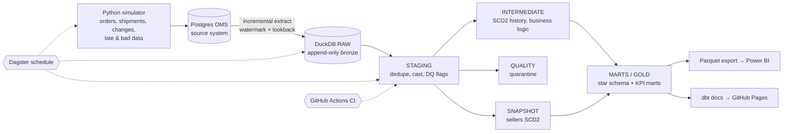
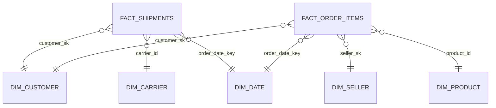

# Supply Chain Analytics Lakehouse


   

A SQL-first, end-to-end ELT platform that incrementally ingests order, shipment and carrier data from an
operational Postgres database, models it into a tested star schema with full **SCD Type 2** history, and
serves delivery-performance KPIs (on-time %, delay streaks, freight cost per kg) to a BI dashboard.
Everything is orchestrated with Dagster and verified in CI on every pull request.

> **Business question:** *Which carriers are missing their delivery SLAs, since when, and what does it cost?*

---

## Architecture



## Data model (gold layer)



| Model | Type | Highlights |
|---|---|---|
| `fact_order_items` | Incremental fact | Lookback window for late data, point-in-time SCD2 joins |
| `fact_shipments` | Incremental fact (accumulating) | Re-processed in_transit → delivered; post-hook evicts later-quarantined rows |
| `dim_customer` | SCD Type 2 (hand-written SQL) | Built from raw change log with `lag`/`lead`, no-op changes collapsed by attribute hash |
| `dim_seller` | SCD Type 2 (dbt snapshot) | Contrast with the hand-written approach |
| `mart_carrier_performance_monthly` | Contract-enforced mart | Rolling 3-month on-time %, MoM change, monthly rank |
| `mart_carrier_delay_streaks` | Analytical mart | Gaps-and-islands detection of consecutive bad days |
| `mart_daily_kpis` | Dashboard mart | Complete date spine, zero-filled |

## Engineering features

- **Incremental ingestion** – per-table high-watermark with a configurable lookback; append-only raw with lineage columns and a load-audit table.
- **Late-arriving & duplicate data** – the simulator back-dates ~3% of records; the lookback re-reads them and staging dedupes with `qualify row_number()`.
- **SCD Type 2 two ways** – rebuildable SQL from the change log vs. a dbt snapshot; trade-offs documented below.
- **Data quality** – 40+ generic and singular tests, a reconciliation test between staging and the incremental fact, quarantine table for invalid rows, source freshness checks, and a warning-level threshold test.
- **Unit tests** – dbt unit test proves the on-time / delay logic with fixed inputs.
- **Data contracts** – enforced column names and types on the scorecard mart consumed by BI.
- **Idempotency** – any step can be re-run; incremental models self-heal within the lookback window, `--full-refresh` rebuilds deterministically.
- **Orchestration** – Dagster asset graph (simulation → raw → every dbt model) with a daily schedule; raw asset keys match dbt sources for end-to-end lineage.
- **CI/CD** – GitHub Actions lints SQL (SQLFluff), seeds a Postgres service, runs a full build, then an incremental build, then freshness checks; dbt docs auto-published to GitHub Pages.

## Quick start

Prerequisites: Python 3.11, Docker Desktop, Git.

```bash
git clone https://github.com/<your-github-username>/supply-chain-lakehouse.git
cd supply-chain-lakehouse
python -m venv .venv
# Windows: .venv\Scripts\activate     macOS/Linux: source .venv/bin/activate
pip install -r requirements.txt
docker compose up -d
python pipeline.py demo          # seed 45 days -> load -> build -> 5 incremental cycles -> export
```

Explore the warehouse:

```bash
python -c "import duckdb; print(duckdb.connect('warehouse/warehouse.duckdb').sql('select * from marts.mart_carrier_performance_monthly order by delivery_month, on_time_rank_in_month'))"
```

Orchestration UI:

```bash
pip install -r requirements-orchestration.txt
dagster dev -f orchestration/definitions.py      # http://localhost:3000
```

## Project structure

```
├── source_db/schema.sql          # OLTP source schema
├── generator/generate.py         # source-system simulator (seeded, reproducible)
├── ingestion/extract_load.py     # incremental EL: Postgres -> DuckDB raw
├── dbt_project/
│   ├── models/staging            # dedupe, typing, DQ flags
│   ├── models/intermediate       # SCD2 history, business logic (+ unit test)
│   ├── models/marts              # star schema + KPI marts (+ contract, exposure)
│   ├── models/quality            # quarantine
│   ├── snapshots/                # dbt snapshot SCD2
│   ├── tests/                    # singular tests (SCD2 integrity, reconciliation)
│   ├── macros/ seeds/
├── orchestration/definitions.py  # Dagster assets + schedule
├── serving/export_marts.py       # gold -> Parquet for Power BI
├── pipeline.py                   # cross-platform runner
└── .github/workflows/            # CI + docs publishing
```

## Design decisions & trade-offs

| Decision | Why | Trade-off |
|---|---|---|
| DuckDB as warehouse | Zero-cost, runs in CI, columnar and fast | Single-writer; swap the dbt profile for Snowflake/BigQuery in production |
| Watermark + lookback instead of log-based CDC | Simple, works on any source with `updated_at` | Misses hard deletes and intermediate versions between loads (Debezium would capture these) |
| Append-only raw | Full audit trail, enables rebuildable SCD2 | Storage grows; would add retention/compaction |
| Hand-written SCD2 for customers | Rebuildable from raw at any time, testable | More SQL to maintain than a snapshot |
| Snapshot SCD2 for sellers | Idiomatic dbt, minimal code | History only exists from when snapshots started; not rebuildable |
| `delete+insert` incremental strategy | Portable across adapters and dbt-duckdb versions | `merge` would be preferred on Snowflake/Databricks |
| Point-in-time joins resolved at load | Facts keep the dimension version valid at order time | A late-arriving dimension change needs `--full-refresh` (documented) |
| Unknown member (`-1`) rows | Facts are never silently dropped | Requires monitoring of `-1` counts |

## Data quality

| Layer | Checks |
|---|---|
| Source | Freshness on `_loaded_at` (warn 24h / error 72h) |
| Staging | Uniqueness after dedupe, accepted values, referential integrity, DQ flags |
| Intermediate | Unit test on on-time/delay logic |
| Marts | Relationships to dims, expression tests, SCD2 overlap & single-current-version tests, staging↔fact reconciliation, contract enforcement |
| Quality | Quarantine table + warning if > 2% of shipments are invalid |

## Results

> Fill these in from your own runs (see `raw._load_audit` and `dbt build` timings).

- Rows processed: `[X]` orders / `[Y]` shipments across `[N]` simulated days
- Full build time: `[X]s`; incremental build time: `[Y]s`
- Tests: `[N]` passing

## Roadmap

- [ ] Log-based CDC with Debezium + Kafka/Redpanda
- [ ] Snowflake target with `merge` strategy and clustering keys
- [ ] Elementary / Great Expectations data-observability dashboard
- [ ] Slim CI (`state:modified+`) with deferred production manifest

## License

MIT
